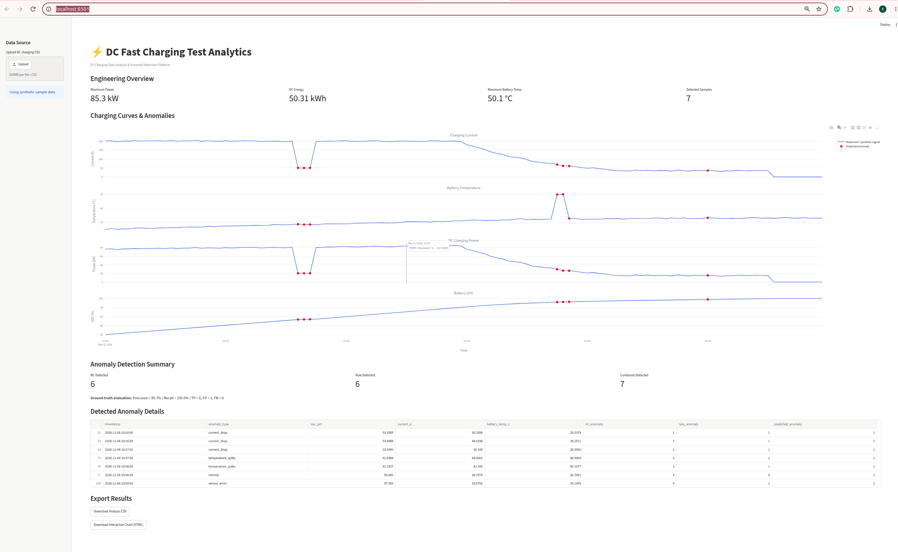

# EV Powertrain Test Analytics Platform

## DC Fast Charging Analytics & Anomaly Detection

A Python-based prototype for automotive test data digitalization, engineering analysis, and machine learning-based anomaly detection.

The first version focuses on synthetic DC fast-charging data. The platform is designed with a modular architecture to support future extensions to electric motor, inverter, and powertrain testing.

## Key Features

- **Synthetic Data Generation:** Simulates DC fast-charging sessions with SOC, voltage, current, power, and battery temperature.
- **Data Preprocessing:** CSV validation, missing-value detection, interpolation, and data quality flags.
- **Engineering Analytics:** DC charging power, cumulative energy, current change rate, SOC change rate, and battery temperature change rate.
- **Anomaly Detection:** Combines Isolation Forest with engineering rules to detect current drops, temperature spikes, and sensor errors.
- **Interactive Dashboard:** Streamlit and Plotly interface for charging curves, KPIs, anomaly visualization, and result export.

## Technology Stack

- Python 3.12
- Pandas & NumPy
- Scikit-learn (Isolation Forest)
- Streamlit & Plotly
- uv for dependency management
- Git & GitHub for version control

## System Workflow

Synthetic Data Generation
    |
    v
CSV Data Loading
    |
    v
Data Preprocessing
    |
    v
Engineering Feature Extraction
    |
    v
ML + Rule-Based Anomaly Detection
    |
    v
Interactive Dashboard & Report Export

## Initial Detection Results

The prototype was evaluated on a synthetic dataset containing 120 samples, including six deliberately injected anomalous samples.

| Metric | Result |
|--------|--------|
| Total samples | 120 |
| Labeled anomalous samples | 6 |
| True Positives | 6 |
| False Positives | 1 |
| False Negatives | 0 |
| Precision | 85.7% |
| Recall | 100% |

These results demonstrate the operation of the prototype on synthetic data only. They do not represent validated performance on real vehicle or charging-station test data.

The synthetic anomaly labels are used for evaluation, not as machine learning input features.

## Getting Started

### 1. Install dependencies

```bash
uv sync
```

### 2. Generate synthetic charging data

```bash
uv run python scripts/generate_data.py
```

### 3. Preprocess the data

```bash
uv run python scripts/preprocess_data.py
```

### 4. Calculate engineering features

```bash
uv run python scripts/analyze_data.py
```

### 5. Run anomaly detection

```bash
uv run python scripts/detect_anomalies.py
```

### 6. Launch the dashboard

```bash
uv run streamlit run app.py
```

Open http://localhost:8501 in your browser.

The dashboard also supports uploading a compatible DC charging CSV file.

## Current Limitations

- Uses simplified synthetic charging behavior.
- Engineering thresholds are tuned for demonstration.
- Isolation Forest is fitted on the dataset being analyzed.
- Real-world test data validation is not yet completed.
- The current prototype is intended for offline analysis rather than real-time safety monitoring.

## Planned Improvements

- Automated unit and integration testing
- Improved anomaly detection and false-positive analysis
- Enhanced reporting and data validation
- Support for real test bench datasets
- Extension to electric motor and inverter test analytics

## Project Purpose

This project demonstrates the integration of automotive testing knowledge, Python programming, engineering data analysis, and machine learning to support test digitalization and data-driven engineering workflows.

## Dashboard Preview

